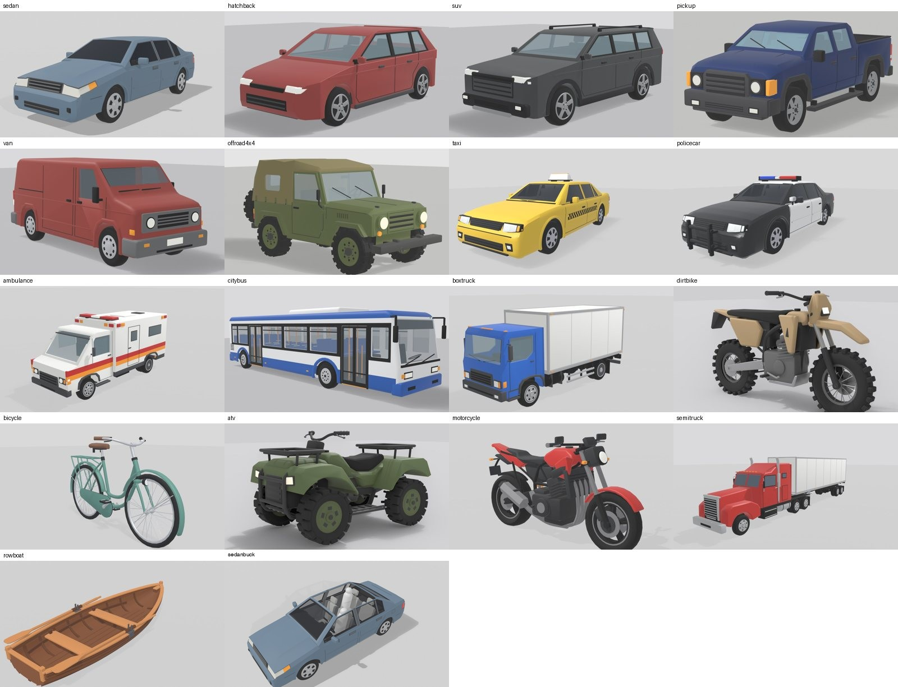
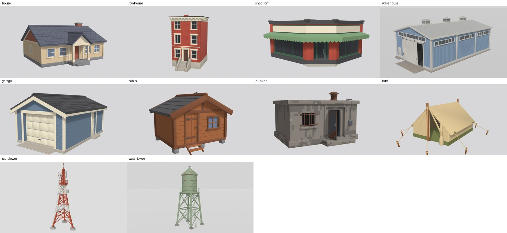
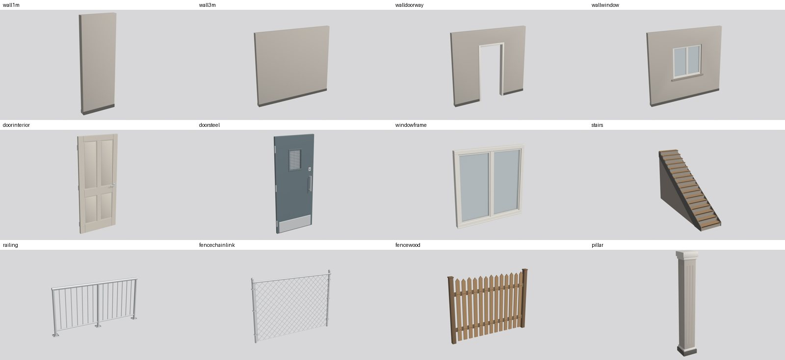
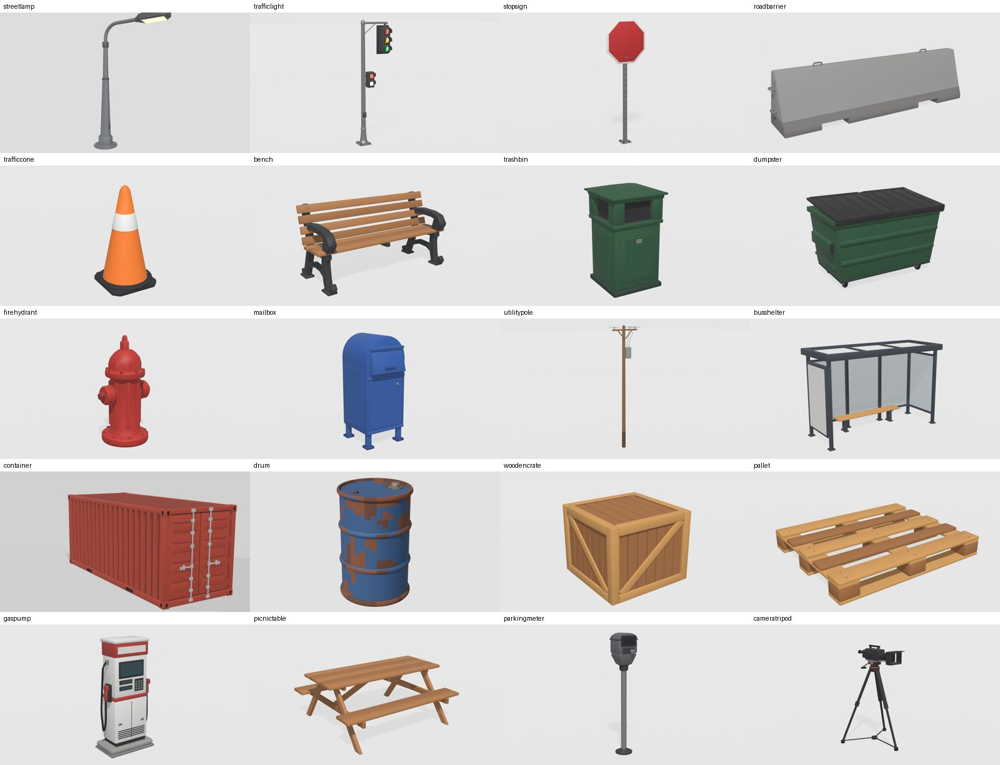
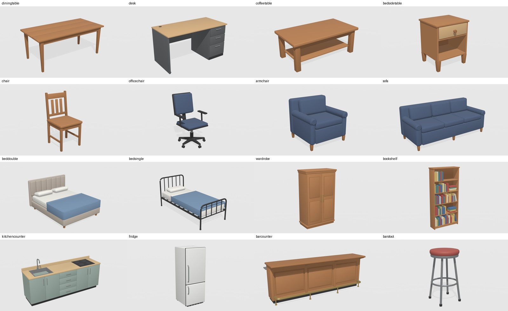
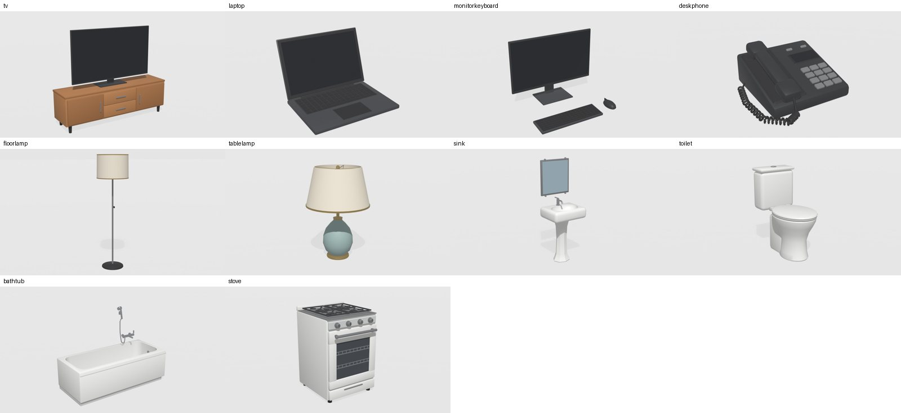
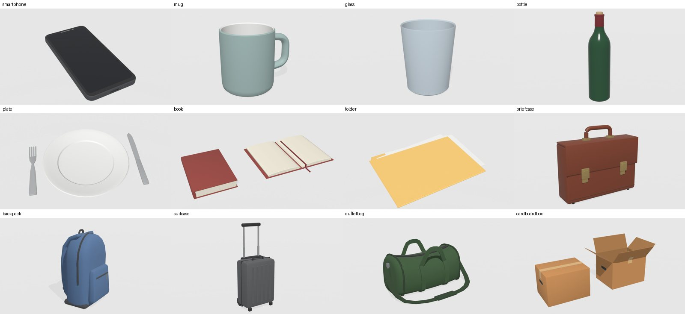
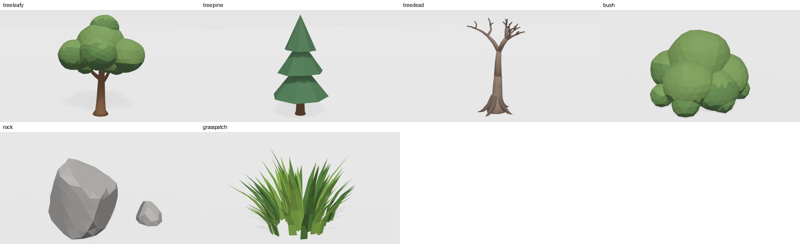
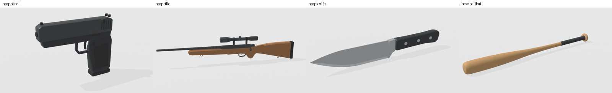

# Previs Props

121 free 3D props for film previs and blocking: vehicles, buildings, modular set pieces, street items, furniture,
fixtures, hand props, nature and prop weapons. One consistent look, flat colours, soft bevelled edges, light
enough for a standalone VR headset.

Status: exploration. First public cut 2026-11-13, 20 more props and the sedan buck added the same day. The models have been rendered in Blender but not yet checked
in a game engine.

## What is here

| Group | Count | Folder |
|---|---|---|
| Vehicles | 18 | `models/vehicles` |
| Buildings and structures | 10 | `models/buildings` |
| Modular set pieces | 17 | `models/set-pieces` |
| Street and yard | 20 | `models/street` |
| Furniture | 21 | `models/furniture` |
| Fixtures and electronics | 13 | `models/fixtures` |
| Hand props | 12 | `models/hand-props` |
| Nature | 6 | `models/nature` |
| Prop weapons | 4 | `models/prop-weapons` |

Each model has its own folder with the FBX, the Blender script that built it (`make_<name>.py`) and a render
(`render.jpg`). `models/index.json` lists every model with its group and file name.

## Gallery

### Vehicles


### Buildings and structures


### Modular set pieces


### Street and yard


### Furniture


### Fixtures and electronics


### Hand props


### Nature


### Prop weapons


## Conventions

- 1 unit = 1 metre, real-world sizes.
- Front faces -Y and up is +Z in Blender. The FBX files are exported for Unity (forward -Z, up Y).
- The origin sits on the ground at the centre of the footprint. Door leaves have it at the hinge edge, hand
  props at the base centre, prop weapons at the grip.
- Each file has one root empty named after the model, with one joined mesh under it.
- Anything a person sits in or on has a child empty named `Seat`.
- `sedanbuck` is the exception to the one-mesh rule. It is the sedan built for shooting inside the car: the
  roof, windshield, rear window, four doors, interior and body are separate meshes under the root, so any of them
  can be hidden to let the camera in. It has a seat point per place (`Seat_Driver`, `Seat_Passenger`,
  `Seat_RearLeft`, `Seat_RearRight`) and clear glass. The grey figures in its renders are scale stand-ins and are
  not in the file.
- Colours only, no image textures. Each model uses at most about ten materials.
- The set pieces snap on a 1 m grid: walls are 0.15 m thick and 2.7 m tall.

## Rebuilding a model

The scripts run in headless Blender 5.1:

```bash
/Applications/Blender.app/Contents/MacOS/Blender -b --python models/street/bench/make_bench.py -- out
```

Each script writes the FBX and its preview renders into the folder given after `--`. They are kept as they were
when the model was built, so a few expect a reference picture or a sibling script next to them and need a small
edit to run on their own.

## How these were made

Every model is an original design built from code. A reference picture was generated for most of them, then a
Blender script was written with Claude (Anthropic) to match it, rendered, compared and corrected. No model here
is copied or extracted from another product or asset pack. The reference pictures are not included.

## Licence

- Models and renders: CC0 1.0, public domain. Use them in any film, game or app, no credit needed. See
  `LICENSE`.
- Scripts: MIT. See `LICENSE-SCRIPTS`.
